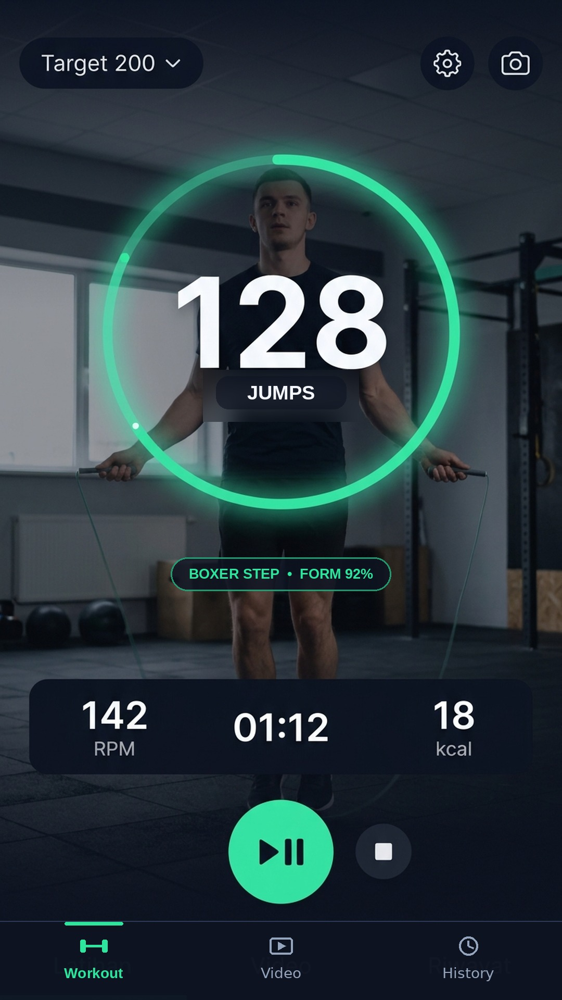
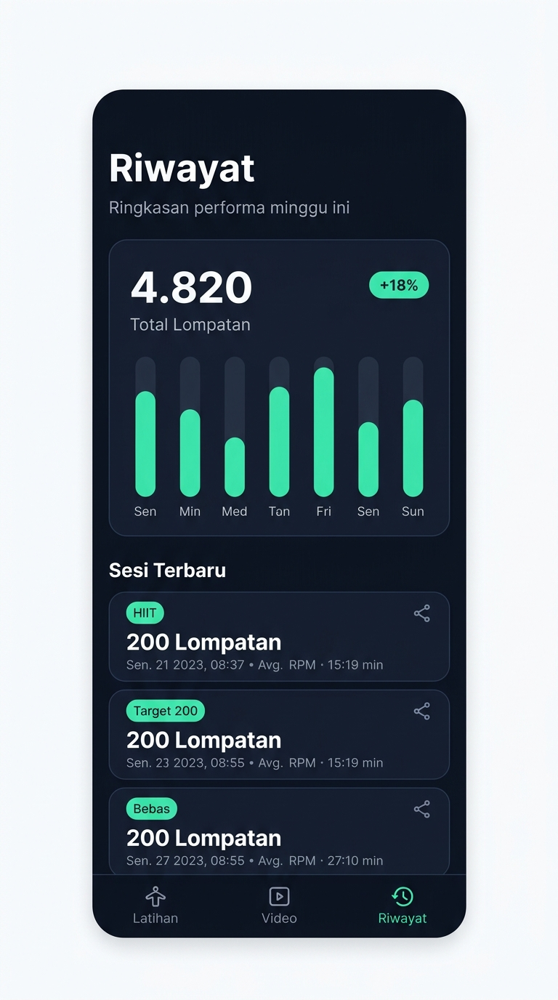
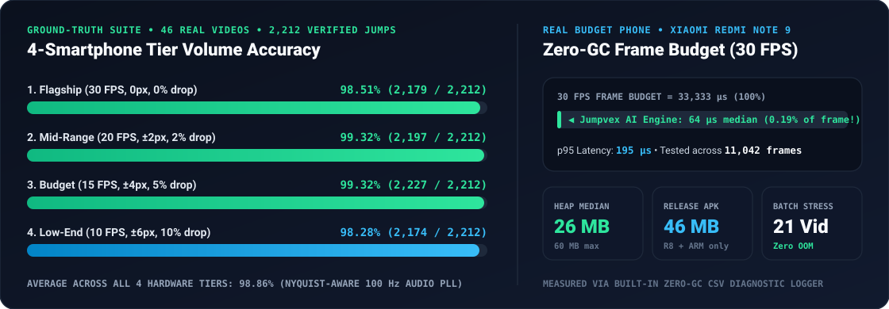
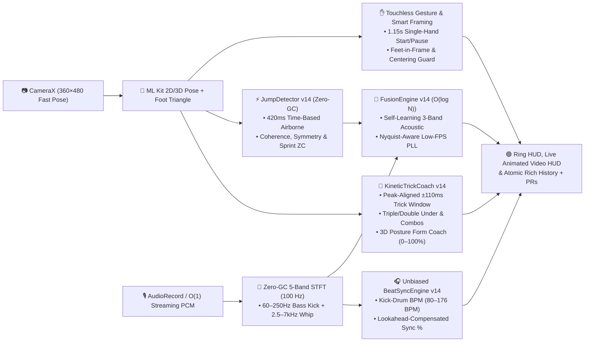

<div align="center">

<a href="https://iganramdani.github.io/Jumpvex/">
  <picture>
    <source media="(prefers-color-scheme: dark)" srcset="docs/assets/hero_banner_dark.svg" />
    <source media="(prefers-color-scheme: light)" srcset="docs/assets/hero_banner_light.svg" />
    
  </picture>
</a>

<br/><br/>

[](https://iganramdani.github.io/Jumpvex/)
[-38BDF8?style=for-the-badge&logo=android&logoColor=0D1321)](https://github.com/iganramdani/Jumpvex/releases/download/v4.0.1/Jumpvex-v4.0.1-release.apk)
[](https://github.com/iganramdani/Jumpvex/releases)
[](https://github.com/iganramdani/Jumpvex/stargazers)
[](LICENSE)

<br/>

[🔬 Web Telemetry Lab](https://iganramdani.github.io/Jumpvex/) •
[✨ Philosophy](#-core-philosophy-99-accuracy--99-lightweight) •
[🆚 Phone-Only vs \$400 Gear](#-how-jumpvex-compares-100-phone-only) •
[📱 UI Gallery](#-modern-two-tone-ui-gallery) •
[📊 Benchmarks](#-real-device--4-smartphone-benchmarks) •
[🧠 Architecture](#-ai-engine-v14-pro-studio-architecture) •
[🗺️ Brutal Roadmap](#️-phone-only-pro-roadmap-v41--v60) •
[🙏 Credits](#-open-source-credits--respect) •
[📦 Download](#-download-apk-release--debug)

<br/>

> 💡 **Interactive Community Tools:**
> [🔬 Inspect Your CSV in Browser](https://iganramdani.github.io/Jumpvex/#telemetry-lab) &nbsp;•&nbsp;
> [🎯 Submit Calibration CSV](https://github.com/iganramdani/Jumpvex/issues/new?template=calibration_contribution.yml) &nbsp;•&nbsp;
> [🐛 Report a Bug](https://github.com/iganramdani/Jumpvex/issues/new?template=bug_report.yml) &nbsp;•&nbsp;
> [✨ Request a Trick](https://github.com/iganramdani/Jumpvex/issues/new?template=trick_request.yml) &nbsp;•&nbsp;
> [🤝 Contributing](CONTRIBUTING.md)

</div>

---

## ✨ Core Philosophy: "99% Accuracy & 99% Lightweight"

**Jumpvex** is built on one relentless engineering principle: **beat \$120–\$500 smartwatches and smart ropes using only the Android smartphone already in your pocket** — zero watch, zero smart rope, zero cloud, zero subscriptions.

| 🎯 99% Accuracy (Competition-Grade Precision) | ⚡ 99% Lightweight (Blazing Fast on Any Phone) |
| :--- | :--- |
| 🧠 **AI Engine v14.0 + 100 Hz 5-Band STFT Hybrid** — fuses full-body 2D/3D + **Heel-to-Toe Foot-Triangle** kinematics with anti-aliased streaming 100 Hz acoustic rope-slap & `60–250 Hz` kick-drum beat analysis. | 🪶 **100% On-Device, Zero Cloud, Zero Watch** — no servers, no wearables, no accounts, full privacy ([`SECURITY.md`](SECURITY.md)), and near-zero latency. |
| 🕺 **Peak-Aligned Trick, Triple Under & Shuffle Coach** — detects **Regular, Boxer Step, Heel-Toe, Criss-Cross, Double Under, Triple Under, High Knees, Side Swing**, plus camera-angle-aware **Melbourne Shuffle** (*Running Man, T-Step, Charleston*), **Combo Chains**, & **3D Posture Form Coach**. | ⚡ **True Zero-GC `O(log N)` Hot Path (`64 µs` on Redmi Note 9)** — pre-allocated FFT/kinematic circular buffers, `O(1)` streaming video audio STFT, atomic crash-safe history, and isolated `PoseOverlay` recomposition. |
| ✋ **Touchless Gym UX & Official IJRU Modes** — raise 1 hand for `1.2s` from 2–4m to Start/Pause hands-free, guided by **Smart Foot-in-Frame Assistant**, plus **IJRU 30s Speed Sprint** & **3m Endurance**. | 🎬 **Live Animated Video HUD Exporter + 46 MB Release APK** — exports Reels/TikTok/Shorts with real-time incrementing jump counter, live RPM & trick callouts via Media3 OpenGL texture reuse while staying `~46 MB`. |

---

## 🆚 How Jumpvex Compares (100% Phone-Only)

| Capability | **Jumpvex (`v4.0.1` → `v6.0`)** | YaoYao | Crossrope AMP | JRC AI | JustJump |
| :--- | :---: | :---: | :---: | :---: | :---: |
| **100% Phone-Only (Zero Watch / Zero Smart Rope)** | ✅ **98.86% Avg** | ❌ Watch / AirPods | ❌ \$119+ Handles | ✅ Camera only | ❌ Manual |
| **Hybrid Vision + 100 Hz Audio PLL** | ✅ **Unique** | ❌ IMU only | ❌ Hall sensor | ❌ Vision only | ❌ |
| **Budget Phone Accuracy (`10–15 FPS`)** | ✅ **98.3%+** | N/A | N/A | ❌ Drops fast | N/A |
| **Trick & Shuffle Dance Classifier** | ✅ **11 Moves + Combos** | ⚠️ Double Under | ❌ | ❌ | ❌ Catalog only |
| **Touchless Hand-Raise Start/Pause** | ✅ **1.2s Single Hand** | ✅ Watch/Voice | ❌ | ✅ Raise Hand | ❌ |
| **Live Animated Counter Video Export** | ✅ **Media3 GPU HUD** | ❌ | ❌ | ❌ | ❌ |
| **Browser CSV Telemetry Oscilloscope** | ✅ **[Web Lab](https://iganramdani.github.io/Jumpvex/)** | ❌ | ❌ | ❌ | ❌ |
| **Official IJRU 30s / 3m Modes** | ✅ **Built-In** | ⚠️ Basic | ✅ Guided | ✅ Sprint | ✅ Drills |
| **Price, Privacy & Open-Source** | ✅ **100% Free GPLv3** | 💰 Paid | 💰 \$119/yr | 💰 Freemium | 💰 Freemium |

---

## 📱 Modern Two-Tone UI Gallery

Crafted with a clean futuristic two-tone palette — **Deep Midnight (`#0D1321`)** + **Ice Mint (`#2EE59D`)** — and a clutter-free **3-Tab Navigation** (*Workout • Video • History*):

<div align="center">
<table>
  <tr>
    <td align="center" width="33%">
      <br/>
      <b>🟢 Tab 1: Dynamic Ring HUD</b><br/>
      <sub>Animated Ice Mint ring, Touchless Hand-Raise Start/Pause, Smart Framing Assistant, Live Trick &amp; Form Coach pill</sub>
    </td>
    <td align="center" width="33%">
      <br/>
      <b>🎬 Tab 2: Multi-Video Studio</b><br/>
      <sub>Jump Rope &amp; Shuffle toggle, unlimited batch queue, Live Animated Counter Video HUD export &amp; auto-saved CSV logs</sub>
    </td>
    <td align="center" width="33%">
      <br/>
      <b>📈 Tab 3: History, PRs &amp; Daily Goal</b><br/>
      <sub>Daily goal bar, active day streak, Personal Records trophy strip, 7-day chart, trick breakdown &amp; 1-tap CSV backup</sub>
    </td>
  </tr>
</table>
</div>

---

## 📊 Real-Device & 4-Smartphone Benchmarks

Continuously verified by [`RealVideosBenchmarkTest.kt`](app/src/test/java/com/jumpropeai/benchmark/RealVideosBenchmarkTest.kt) across **46 real-world jump rope videos** ([`ground_truth_all_videos.csv`](ground_truth_all_videos.csv), `2,212` verified jumps) and real budget hardware (**Xiaomi Redmi Note 9, Android 12**, `21` consecutive batch videos / `11,042` frames):

<div align="center">
  
</div>

<p align="center">
  🔬 <b>Want to inspect a real Redmi Note 9 session frame-by-frame?</b>
  <a href="https://iganramdani.github.io/Jumpvex/#telemetry-lab">Open it live in the Jumpvex Web Telemetry Lab →</a>
</p>

---

## 🧠 AI Engine v14 Pro Studio Architecture



---

## 🎛️ Interactive Feature Explorer (Click to Expand)

<details>
<summary><b>🚀 Quick Start &amp; Best Setup Guide (60 Seconds)</b></summary>
<br/>

1. **Prop your phone** 2–3 meters away so both your head and feet fit inside the frame *(check your exact room distance in the [Web Framing Calculator](https://iganramdani.github.io/Jumpvex/#physics-calc))*.
2. Check the **Smart Framing pill** at the top of the screen — once it turns Ice Mint (`Full body locked • Raise 1 hand to start`), you're perfectly aligned.
3. **Hands-Free Start:** Raise **one hand** clearly above your head for `1.2 seconds` to start the countdown without walking back to your phone.
4. **Calibrate Your Profile:** Open **Settings (⚙️)** to slide your exact **Body Weight (`35–150 kg`)**, pick your **Rope Type** (*Speed Cable, PVC, Beaded, Weighted 0.5/1.0 lb, Cordless*), and set your **Daily Jump Goal**.

</details>

<details>
<summary><b>🏋️ 7 Workout &amp; Official IJRU Competition Modes</b></summary>
<br/>

- **🔥 Free Mode:** Custom session name + custom audio milestone interval (`5 – 1,000` jumps).
- **🎯 Target Jumps:** Quick presets or any custom count (`1 – 99,999` jumps) synced to the dynamic ring gauge.
- **⏱️ Target Time:** Quick presets or custom **Minutes + Seconds** countdown timer.
- **⚡ HIIT Interval:** Custom **Work**, **Rest**, and **Rounds** with live total duration preview and automatic English TTS phase cues.
- **🕺 Shuffle & Tricks:** Counts both jump rope tricks and rhythmic Melbourne Shuffle steps (*Running Man, T-Step, Charleston*) synced to Music BPM.
- **🏆 IJRU 30s Sprint:** Official competition 30-second speed-sprint benchmark powered by 100 Hz acoustic + ankle tracking.
- **🏆 IJRU 3m Endurance:** Official competition 3-minute endurance test tracking sustained cadence, form stability, and trips.

</details>

<details>
<summary><b>🎬 Multi-Video Batch Studio &amp; Live Animated Counter Video HUD</b></summary>
<br/>

- **Dynamic Animated Video HUD Exporter:** Burn a live, frame-accurate jump counter, real-time RPM, streak, calories, and active trick callout onto your workout video via Media3 OpenGL texture reuse — ready for Reels, Shorts & TikTok!
- **Jump Rope & Shuffle Modes + Multi-Video Queue:** Select 1 or unlimited videos at once (`OpenMultipleDocuments`) with O(1)-RAM streaming anti-aliased audio STFT so even multi-hour videos never OOM.
- **Unlimited Auto-Save Debug Telemetry:** Streams frame-by-frame CSV telemetry in background IO directly to **`Documents/Jumpvex/DebugLogs/`** — inspectable instantly in the [Jumpvex Web Telemetry Lab](https://iganramdani.github.io/Jumpvex/#telemetry-lab).

</details>

<details>
<summary><b>🛠️ Build from Source &amp; Run Unit Tests</b></summary>
<br/>

```bash
# Clone the official Jumpvex repository
git clone https://github.com/iganramdani/Jumpvex.git
cd Jumpvex

# Run all 27 unit tests (AI Engine v14, Touchless Gestures, Streaming STFT, Fusion, BeatSync, IJRU Modes)
./gradlew testDebugUnitTest

# Build R8-minified, ARM-optimized Release APK (~46 MB)
./gradlew assembleRelease

# Build Debug APK (with debug symbols for development & profiling)
./gradlew assembleDebug
```

</details>

---

## 🗺️ Phone-Only Pro Roadmap (`v4.1` → `v6.0`)

**100% Smartphone-Native** — every upcoming milestone is engineered to run on a budget Android phone (`< 50 MB` APK, Zero-GC) with **zero smartwatch and zero smart rope required**. Want to build one with us? [Open an Issue or PR](CONTRIBUTING.md)!

- [x] **v3.0–v3.3:** Zero-GC `O(log N)` Vision + 100 Hz STFT Fusion, Heel-to-Toe Foot-Triangle, Shuffle Dance & Batch Video Studio
- [x] **v4.0 (`v4.0.1` Current):** AI Engine v14 Pro Studio — Touchless Hand-Raise Start/Pause, Smart Camera Framing, Peak-Aligned Trick Window (`±110 ms`), Triple Under, Dynamic Live Animated Video HUD, Official IJRU 30s/3m Modes, Athlete Profile & Rope Physics, Atomic Rich History + PRs + CSV Backup
- [x] **Interactive Repo & Web Lab:** Animated Dark/Light SVG Hero, Vector Benchmark Charts, YAML Issue Forms & **[Browser CSV Telemetry Oscilloscope](https://iganramdani.github.io/Jumpvex/)**
- [ ] **v4.1 — Live Creator Broadcast Studio:** 1-Pass Direct Live Camera Recording + GPU HUD (`CameraX StreamSharing`), X-Ray Neon Skeleton Burn-In & `0.25x` Slow-Mo Frame-by-Frame Trip/Trick Inspector
- [ ] **v4.2 — Phone-Only Sensor Mastery (Zero Watch!):** **Pocket / Waistband 100 Hz IMU Mode** (screen-off workouts without camera), **Camera-Lens Contact rPPG Heart Rate & 60s Recovery (HRR-60)**, Double-Clap & Earbud `MediaSession` Control, plus Built-In Target RPM Audio Pacemaker (`100–240 RPM`)
- [ ] **v4.5 — AI Engine v15 Force-Plate & Optical Rope Lab:** Flight Height (`cm`), Ground Contact Time (`ms`), Reactive Strength Index (`RSI`), Sub-Toe Optical Rope-Pass Tracker, **20 Freestyle & Shuffle Moves** (*EB Cross, Toad, Backward Skip, DU-Cross, Skiers, Polly Pocket*), and **AI Trip Root-Cause Autopsy**
- [ ] **v5.0 — Ghost Rival, 2-Player Arena & Skill Academy:** Live Personal-Best Ghost Pacer, **1-Phone 2-Player Interleaved Split-Screen Battle Mode**, AI-Verified Interactive Skill Tree, Zero-Bloat Native SQLite WAL + 365-Day Heatmap
- [ ] **v6.0 — Extreme Silicon Sympathy:** Jetpack Baseline Profiles (`-40%` cold start), `< 50 µs` hot path & Pre-Throttling Thermal Governor

---

## ❓ Interactive FAQ

<details>
<summary><b>Do I need a smartwatch, AirPods, or a smart jump rope?</b></summary>
<br/>
<b>No!</b> Jumpvex is <b>100% Phone-Only</b>. Your smartphone's built-in camera, microphone, IMU sensors, and speaker do everything — zero wearables or paid hardware required.
</details>

<details>
<summary><b>Does Jumpvex upload my camera feed, videos, or CSV logs to the internet?</b></summary>
<br/>
<b>Never.</b> 100% of pose detection, STFT audio DSP, trick classification, video rendering, and even our <a href="https://iganramdani.github.io/Jumpvex/">Web Telemetry Lab</a> runs strictly on your own device. Internet permission is used <i>only</i> for the optional GitHub Releases update check.
</details>

<details>
<summary><b>Will Jumpvex run smoothly on older / budget Android phones?</b></summary>
<br/>
Yes! Jumpvex is specifically calibrated and stress-tested on a <b>Xiaomi Redmi Note 9 (Android 12)</b>, averaging <code>64 µs/frame</code> CPU time (<code>0.19%</code> of a 30 FPS frame) and <code>26 MB</code> heap memory. Even at 10–15 FPS, our Nyquist-aware Audio PLL maintains <b>98.3%+</b> accuracy.
</details>

---

## 🙏 Open-Source Credits & Respect

**Jumpvex** stands on the shoulders of extraordinary open-source engineers, researchers, and jump rope athletes. Full license attributions are maintained in [`CREDITS.md`](CREDITS.md) — huge respect and gratitude to:

| Project / Organization | Role in Jumpvex | License |
| :--- | :--- | :--- |
| **[JetBrains & Kotlin Contributors](https://github.com/JetBrains/kotlin)** | Kotlin `2.0.21` language & `kotlinx.coroutines` structured concurrency | Apache-2.0 |
| **[Google AndroidX / Jetpack Team](https://github.com/androidx/androidx)** | Jetpack Compose, Material 3, CameraX `1.4.0`, Lifecycle & Core KTX | Apache-2.0 |
| **[AndroidX Media3 Team](https://github.com/androidx/media)** | Hardware-accelerated `Media3 Transformer` & `BitmapOverlay` OpenGL video export | Apache-2.0 |
| **[Google ML Kit & MediaPipe Team](https://developers.google.com/ml-kit/vision/pose-detection)** | Real-time on-device 2D/3D BlazePose landmark inference (`pose-detection`) | ML Kit Terms / Apache-2.0 |
| **[JUnit Team](https://github.com/junit-team/junit4)** | Unit & regression benchmark testing framework | EPL-1.0 |
| **[Gradle & Android Gradle Plugin Teams](https://github.com/gradle/gradle)** | Build automation, R8 code shrinking & resource optimization | Apache-2.0 |
| **DSP & Sports Science Standards** | Cooley–Tukey Radix-2 FFT, ACSM Compendium of Physical Activities (MET), & [IJRU](https://ijru.sport) official competition rules | Public Standards |
| **Jump Rope & Footwork Community** | Athletes & creators including `@cenxiaolin1` (competition speed-sprint), `@alwaysghadi` (boxing footwork), and the `r/jumprope` & Melbourne Shuffle communities whose public demonstrations enabled real-world calibration | Community Credit |

---

## 📦 Download APK (Release & Debug)

<div align="center">

[-2EE59D?style=for-the-badge&logo=android&logoColor=0D1321)](https://github.com/iganramdani/Jumpvex/releases/download/v4.0.1/Jumpvex-v4.0.1-release.apk)
&nbsp;
[](https://github.com/iganramdani/Jumpvex/releases/download/v4.0.1/Jumpvex-v4.0.1-debug.apk)

<sub>Android 7.0+ (API 24+) • 100% On-Device • Free &amp; Open-Source • <a href="https://github.com/iganramdani/Jumpvex/releases/tag/v4.0.1">View Full Release Notes &amp; SHA-256 Checksums</a></sub>

</div>

---

## ⚖️ Open-Source License, Copyright & Anti-Plagiarism

**Jumpvex** is released as **Free and Open-Source Software** under the strict **[GNU General Public License v3.0 (GPL-3.0)](LICENSE)** so everyone worldwide can benefit, learn, and contribute — **while firmly protecting original authorship against closed-source plagiarism**:

> **Copyright © 2026 Igan Ramdani ([`@iganramdani`](https://github.com/iganramdani)). All rights reserved under GNU GPL v3.0.**

- ✅ **Allowed:** Free use, study, modification, and community Pull Requests.
- 📜 **Attribution Required:** Any copy or fork **must preserve the original copyright notice** ([`NOTICE`](NOTICE)) and [`CREDITS.md`](CREDITS.md), and clearly document all modifications.
- 🔒 **Anti-Plagiarism (*Strong Copyleft*):** Repackaging or monetizing **Jumpvex** (including AI Engine v14, STFT DSP, or UI) as a closed-source / proprietary app is strictly prohibited. All derivative works **must remain open-source under the same GPL-3.0 license**.
- 🛡️ **Brand Protection:** The **Jumpvex** name and official visual identity belong to the original author; unofficial forks must use a distinct app name and package ID.
