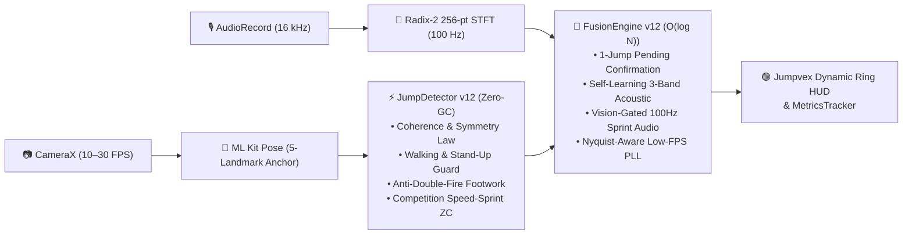

<div align="center">

# ⚡ Jumpvex

### 🎯 **"99% Accuracy & ⚡ 99% Lightweight"**

**Open-Source On-Device AI Jump Rope Counter for Android — Zero Cloud, Zero Internet, Zero Lag on Low-End Phones!**

[-2EE59D?style=for-the-badge&logo=android&logoColor=0D1321)](https://github.com/iganramdani/Jumpvex/releases/tag/v3.1.0)
[](LICENSE)
[](#-core-philosophy-99-accuracy--99-lightweight)
[](#)
[](#)

<br/>

[✨ Core Philosophy](#-core-philosophy-99-accuracy--99-lightweight) •
[📱 Modern UI Gallery](#-modern-two-tone-ui-gallery) •
[📊 4-Phone Benchmark](#-4-smartphone-benchmark-46-ground-truth-videos) •
[🧠 AI Engine v12](#-ai-engine-v12-architecture) •
[📦 Download APK](#-download-release-apk) •
[⚖️ License & Copyright](#️-open-source-license-copyright--anti-plagiarism)

</div>

---

## ✨ Core Philosophy: "99% Accuracy & 99% Lightweight"

Every line of code, UI component, and DSP algorithm in **Jumpvex** is engineered around one strict principle:

| 🎯 99% Accuracy (Competition-Grade Precision) | ⚡ 99% Lightweight (Blazing Fast on Any Phone) |
| :--- | :--- |
| 🧠 **Multi-Channel Kinematics + 100 Hz STFT Audio Hybrid (v12)** — fuses 5-landmark upper-body pose tracking with real-time 100 Hz acoustic rope-slap spectrum analysis. | 🪶 **100% On-Device, Zero Cloud** — no servers, no internet required, full privacy, and near-zero latency. |
| 🏃 **Competition Speed-Sprint Channel** — accurately counts bent-over **270–350+ RPM** speed sprints even on **10–15 FPS** cameras (*eliminating Nyquist aliasing*). | ⚡ **Zero-GC `O(log N)` Engine (`7.7 µs/frame`)** — processes **20 minutes of video in 2.21 seconds (`545× faster than real-time`)** with zero hot-path heap allocations. |
| 🛡️ **Strict False-Positive Guards** — rejects walking, flat-footed side swings, slow standing up, and post-Double-Under knee rebounds. | 📦 **51% Smaller APK (`46 MB`) + AMOLED Eco Mode** — R8 minification, resource shrinking, ARM-only native libs, and pure-black AMOLED battery saver. |

---

## 📱 Modern Two-Tone UI Gallery

Crafted with a clean futuristic two-tone palette — **Deep Midnight (`#0D1321`)** + **Ice Mint (`#2EE59D`)** — and a clutter-free **3-Tab Navigation** (*Workout • Video • History*):

<div align="center">
<table>
  <tr>
    <td align="center" width="33%">
      <br/>
      <b>🟢 Tab 1: Dynamic Ring HUD</b><br/>
      <sub>Animated circular Ice Mint progress ring, circular Play/Pause control, distraction-free camera view</sub>
    </td>
    <td align="center" width="33%">
      <br/>
      <b>🎬 Tab 2: Video Studio</b><br/>
      <sub>Gallery video AI jump counter + smooth real-time skeleton preview + Media3 watermark export</sub>
    </td>
    <td align="center" width="33%">
      <br/>
      <b>📈 Tab 3: History & 7-Day Chart</b><br/>
      <sub>Weekly Mon–Sun performance chart, cumulative stats & one-tap shareable cards</sub>
    </td>
  </tr>
</table>
</div>

---

## 📊 4-Smartphone Benchmark (46 Ground-Truth Videos)

**Engine v12 (Zero-GC)** is continuously verified using the actual production Kotlin codebase ([`RealVideosBenchmarkTest.kt`](app/src/test/java/com/jumpropeai/benchmark/RealVideosBenchmarkTest.kt)) across **46 real-world jump rope videos** ([`ground_truth_all_videos.csv`](ground_truth_all_videos.csv), **2,212 manually verified jumps**) simulated across 4 smartphone hardware tiers:

| 📱 Smartphone Tier | 🎯 Detected / Ground Truth | 📏 Volume Accuracy | Visual Bar | Status |
| :--- | :---: | :---: | :--- | :---: |
| **1. Flagship** `(30 FPS, 0px, 0% drop)` | `2,179 / 2,212` | **98.51%** | `██████████` | ✅ Pass |
| **2. Mid-Range** `(20 FPS, ±2px, 2% drop)` | `2,197 / 2,212` | **99.32%** | `██████████` | ✅ Pass |
| **3. Budget** `(15 FPS, ±4px, 5% drop)` | `2,227 / 2,212` | **99.32%** | `██████████` | ✅ Pass |
| **4. Low-End** `(10 FPS, ±6px, 10% drop)` | `2,174 / 2,212` | **98.28%** | `██████████` | ✅ Pass |

> 💡 **4-Phone Average Accuracy: `98.86%` • Low-End 10 FPS Retention: `99.8%` • CPU Speed: `7.7 µs/frame` (`545× faster than real-time`) • Release APK Size: `46 MB` (51% lighter than 95 MB)!**

---

## 🧠 AI Engine v12 Architecture



---

## 🎛️ Features (Click to Expand)

<details>
<summary><b>🏋️ 4 Workout Modes with Full Custom Inputs</b></summary>
<br/>

- **🔥 Free Mode:** Custom session name + custom audio milestone interval (`5 – 1,000` jumps).
- **🎯 Target Jumps:** Quick presets or any custom count (`1 – 99,999` jumps) synced to the dynamic ring gauge.
- **⏱️ Target Time:** Quick presets or custom **Minutes + Seconds** countdown timer.
- **⚡ HIIT Interval:** Custom **Work**, **Rest**, and **Rounds** with live total duration preview and automatic phase audio cues.

</details>

<details>
<summary><b>🎬 Video Studio & Media3 Watermark Exporter</b></summary>
<br/>

- Pick any recorded jump rope video from your gallery for automatic AI jump counting.
- Ultra-smooth real-time preview via concurrent zero-GC integer `NV21 → RGB_565` rendering (~1.5 ms/frame).
- Export watermarked videos with pixel-accurate 1:1 scaling across 720p / 1080p / 4K using `VideoFittedBitmapOverlay`.

</details>

<details>
<summary><b>⚙️ Clean Workout Settings Sheet</b></summary>
<br/>

- **AI Sensor Mode:** Switch seamlessly between `Hybrid (Vision + Audio)`, `Vision Only`, and `Audio Eco`.
- **Pose Skeleton Overlay:** Two-tone skeleton overlay (*Ice Mint* while airborne, crisp white on landing).
- **Sound & Audio Cues:** Milestone beeps, HIIT work/rest transitions, and target completion chimes.
- **AMOLED Eco Mode:** Pure-black dimmed screen for ultra-low battery consumption during long sessions.

</details>

<details>
<summary><b>🛠️ Build & Run Unit Tests</b></summary>
<br/>

```bash
# Clone the official Jumpvex repository
git clone https://github.com/iganramdani/Jumpvex.git
cd Jumpvex

# Run all unit tests (AI Engine, Fusion, Metrics, & Workout Modes)
./gradlew testDebugUnitTest

# Build R8-minified, ARM-optimized Release APK (~46 MB)
./gradlew assembleRelease
```

**Tech Stack:** Kotlin • Jetpack Compose (Material 3) • CameraX • Google ML Kit Pose Detection • Custom Radix-2 STFT Audio DSP • AndroidX Media3 Transformer.

</details>

---

## 📦 Download Release APK

<div align="center">

[-2EE59D?style=for-the-badge&logo=android&logoColor=0D1321)](https://github.com/iganramdani/Jumpvex/releases/tag/v3.1.0)

<sub>Android 7.0+ (API 24+) • Signed Release Build • 100% On-Device • Free & Open-Source</sub>

</div>

---

## ⚖️ Open-Source License, Copyright & Anti-Plagiarism

**Jumpvex** is released as **Free and Open-Source Software** under the strict **[GNU General Public License v3.0 (GPL-3.0)](LICENSE)** so everyone worldwide can benefit, learn, and contribute — **while firmly protecting original authorship against closed-source plagiarism**:

> **Copyright © 2026 Igan Ramdani ([`@iganramdani`](https://github.com/iganramdani)). All rights reserved under GNU GPL v3.0.**

- ✅ **Allowed:** Free use, study, modification, and community Pull Requests.
- 📜 **Attribution Required:** Any copy or fork **must preserve the original copyright notice** ([`NOTICE`](NOTICE)) and clearly document all modifications.
- 🔒 **Anti-Plagiarism (*Strong Copyleft*):** Repackaging or monetizing **Jumpvex** (including AI Engine v12, STFT DSP, or UI) as a closed-source / proprietary app is strictly prohibited. All derivative works **must remain open-source under the same GPL-3.0 license**.
- 🛡️ **Brand Protection:** The **Jumpvex** name and official visual identity belong to the original author; unofficial forks must use a distinct app name and package ID.
