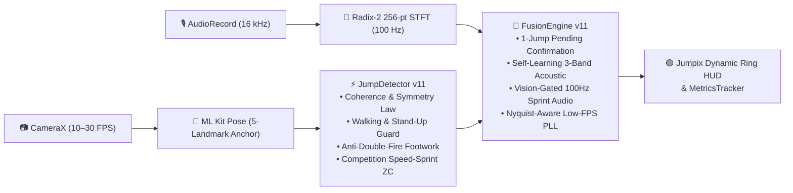

<div align="center">

# ⚡ Jumpix

### 🎯 **"99% Akurasi & ⚡ 99% Ringan"**

**Penghitung Lompat Tali AI Open-Source untuk Android — 100% On-Device, Tanpa Internet, Tanpa Lag di HP Low-End!**

[-2EE59D?style=for-the-badge&logo=android&logoColor=0D1321)](https://github.com/iganramdani/Jumpix/releases/tag/v3.0.0)
[](LICENSE)
[](#-pedoman-inti-99-akurasi--99-ringan)
[](#)
[](#)

<br/>

[✨ Pedoman Inti](#-pedoman-inti-99-akurasi--99-ringan) •
[📱 Galeri UI](#-galeri-ui-modern-two-tone) •
[📊 Benchmark 4 HP](#-benchmark-4-smartphone-46-video-ground-truth) •
[🧠 Arsitektur AI](#-arsitektur-engine-ai-v11) •
[📦 Download APK](#-download-release-apk) •
[⚖️ Lisensi & Hak Cipta](#️-lisensi-open-source-hak-cipta--anti-plagiat)

</div>

---

## ✨ Pedoman Inti: "99% Akurasi & 99% Ringan"

Setiap baris kode, desain UI, hingga algoritma DSP di **Jumpix** dibangun mengikuti satu kompas utama:

| 🎯 99% Akurasi (Presisi Kelas Kompetisi) | ⚡ 99% Ringan (Ngebut di Semua Smartphone) |
| :--- | :--- |
| 🧠 **Multi-Channel Kinematics + 100 Hz STFT Audio Hybrid (v11)** — menggabungkan pose tubuh 5-landmark + analisis spektrum suara tali 100 Hz secara *real-time*. | 🪶 **100% On-Device Tanpa Cloud** — tidak butuh server, tidak butuh kuota internet, privasi terjaga & latensi nyaris nol. |
| 🏃 **Competition Speed-Sprint Channel** — mampu menghitung sprint membungkuk **270–350+ RPM** meski kamera HP hanya **10–15 FPS** (*anti Nyquist-aliasing*). | 🔋 **Mode Hemat AMOLED & Audio Eco** — layar bisa diredupkan hitam pekat dan kamera otomatis mati di tab Video/Riwayat untuk hemat baterai maksimal. |
| 🛡️ **Anti-False-Positive Ketat** — menolak jalan kaki (*walking guard*), *side swing* kaki menempel, berdiri perlahan, hingga pantulan lutut setelah *Double-Under*. | 🚀 **Zero-GC Fast Preview** — konversi `NV21 → RGB_565` langsung pakai *reusable buffer* (~1,5 ms/frame), mulus tanpa patah-patah di Video Studio. |

---

## 📱 Galeri UI Modern Two-Tone

Dirancang ulang total dengan filosofi minimalis futuristik **Deep Midnight (`#0D1321`)** + **Ice Mint (`#2EE59D`)** dan navigasi **3 Tab Bersih** (*Latihan • Video • Riwayat*):

<div align="center">
<table>
  <tr>
    <td align="center" width="33%">
      <br/>
      <b>🟢 Tab 1: Dynamic Ring HUD</b><br/>
      <sub>Cincin progres melingkar dinamis, tombol bulat <i>Ice Mint</i>, HUD bebas semrawut</sub>
    </td>
    <td align="center" width="33%">
      <br/>
      <b>🎬 Tab 2: Video Studio</b><br/>
      <sub>Analisis rekaman galeri + preview <i>skeleton</i> halus + ekspor watermark Media3</sub>
    </td>
    <td align="center" width="33%">
      <br/>
      <b>📈 Tab 3: Riwayat & Grafik 7 Hari</b><br/>
      <sub>Ringkasan performa mingguan <i>Sen–Min</i> & bagikan kartu latihan</sub>
    </td>
  </tr>
</table>
</div>

---

## 📊 Benchmark 4 Smartphone (46 Video Ground-Truth)

Engine **v12 (Zero-GC)** diuji langsung menggunakan kode produksi Kotlin ([`RealVideosBenchmarkTest.kt`](app/src/test/java/com/jumpropeai/benchmark/RealVideosBenchmarkTest.kt)) pada seluruh **46 video dunia nyata** ([`ground_truth_all_videos.csv`](ground_truth_all_videos.csv), total **2.212 lompatan terverifikasi**) melintasi 4 simulasi perangkat:

| 📱 Profil Smartphone | 🎯 Hasil Hitung | 📏 Akurasi (VolAcc) | Visual Bar | Status |
| :--- | :---: | :---: | :--- | :---: |
| **1. Flagship** `(30 FPS, 0px, 0% drop)` | `2.179 / 2.212` | **98,51%** | `██████████` | ✅ Lulus |
| **2. Mid-Range** `(20 FPS, ±2px, 2% drop)` | `2.197 / 2.212` | **99,32%** | `██████████` | ✅ Lulus |
| **3. Budget** `(15 FPS, ±4px, 5% drop)` | `2.227 / 2.212` | **99,32%** | `██████████` | ✅ Lulus |
| **4. Low-End** `(10 FPS, ±6px, 10% drop)` | `2.174 / 2.212` | **98,28%** | `██████████` | ✅ Lulus |

> 💡 **Rata-rata 4 Smartphone: `98,86%` • Retensi Low-End 10 FPS: `99,8%` • Kecepatan CPU: `7,7 µs/frame` (`545× lebih cepat dari real-time`) • Ukuran APK Release: hanya `46 MB` (turun 51% dari 95 MB)!**

---

## 🧠 Arsitektur Engine AI v11



---

## 🎛️ Fitur Interaktif (Klik untuk Membuka Detail)

<details>
<summary><b>🏋️ 4 Mode Latihan + Custom Input Penuh</b></summary>
<br/>

- **🔥 Mode Bebas (Free):** Custom nama sesi + custom interval *milestone* audio (`5 – 1.000` lompatan).
- **🎯 Target Lompatan:** Preset cepat atau custom bebas (`1 – 99.999` lompatan) dengan cincin progres otomatis.
- **⏱️ Target Waktu:** Preset cepat atau custom **Menit + Detik** dengan hitung mundur presisi.
- **⚡ HIIT Interval:** Custom durasi **Kerja**, **Istirahat**, dan **Jumlah Ronde** lengkap dengan pratinjau total durasi & fase audio otomatis.

</details>

<details>
<summary><b>🎬 Video Studio & Watermark Exporter (Media3 Transformer)</b></summary>
<br/>

- Pilih rekaman lompat tali langsung dari galeri untuk dihitung otomatis oleh Engine AI v11.
- Preview *real-time* super halus menggunakan konversi integer `NV21 → RGB_565` secara konkuren.
- Ekspor video dengan **kartu watermark statistik transparan `JUMPIX`** berukuran presisi 1:1 di segala resolusi (720p/1080p/4K) berkat `VideoFittedBitmapOverlay`.

</details>

<details>
<summary><b>⚙️ Pengaturan Latihan Rapi di Settings Sheet</b></summary>
<br/>

- **Mode Sensor AI:** `Hybrid (Vision + Audio)` / `Vision Saja` / `Audio Eco`.
- **Overlay Skeleton Pose:** Rangka tubuh Two-Tone (*Ice Mint* saat melayang, putih saat mendarat).
- **Suara & Cue Latihan:** Bunyi *milestone*, fase HIIT, dan target tercapai.
- **Mode Hemat AMOLED:** Layar hitam pekat untuk menghemat baterai saat sesi panjang.

</details>

<details>
<summary><b>🛠️ Panduan Build & Jalankan Unit Test</b></summary>
<br/>

```bash
# Clone repositori resmi Jumpix
git clone https://github.com/iganramdani/Jumpix.git
cd Jumpix

# Jalankan seluruh unit test (termasuk AI, Fusion, Metrics, & Workout Modes)
./gradlew testDebugUnitTest

# Build Release APK (signed & siap pasang)
./gradlew assembleRelease
```

**Tech Stack:** Kotlin • Jetpack Compose (Material 3) • CameraX • Google ML Kit Pose Detection • Custom Radix-2 STFT Audio DSP • AndroidX Media3 Transformer.

</details>

---

## 📦 Download Release APK

<div align="center">

[-2EE59D?style=for-the-badge&logo=android&logoColor=0D1321)](https://github.com/iganramdani/Jumpix/releases/tag/v3.0.0)

<sub>Android 7.0+ (API 24+) • Signed Release Build • 100% On-Device • Gratis & Open-Source</sub>

</div>

---

## ⚖️ Lisensi Open-Source, Hak Cipta & Anti-Plagiat

**Jumpix** dirilis secara **Open-Source** di bawah lisensi ketat **[GNU General Public License v3.0 (GPL-3.0)](LICENSE)** agar semua orang dapat ikut merasakan manfaat, belajar, dan berkontribusi — **sambil melindungi hak cipta asli dari plagiarisme tertutup**:

> **Copyright © 2026 Igan Ramdani ([`@iganramdani`](https://github.com/iganramdani)). All rights reserved under GNU GPL v3.0.**

- ✅ **Boleh:** Menggunakan gratis, mempelajari kode, memodifikasi, dan berkontribusi lewat Pull Request.
- 📜 **Wajib Atribusi:** Setiap salinan atau *fork* **wajib mempertahankan pemberitahuan hak cipta asli** ([`NOTICE`](NOTICE)) dan mencantumkan perubahan yang dibuat.
- 🔒 **Anti-Plagiat (*Strong Copyleft*):** Dilarang keras mengambil kode **Jumpix** (termasuk Engine AI v11, DSP STFT, atau UI) untuk dijadikan aplikasi *closed-source* / berbayar tertutup. Setiap karya turunan **wajib ikut dibuka kode sumbernya di bawah lisensi GPL-3.0 yang sama**.
- 🛡️ **Perlindungan Merek:** Nama **Jumpix** dan identitas resminya dimiliki oleh pencipta asli; *fork* tidak resmi dilarang menyamar sebagai aplikasi resmi **Jumpix**.
