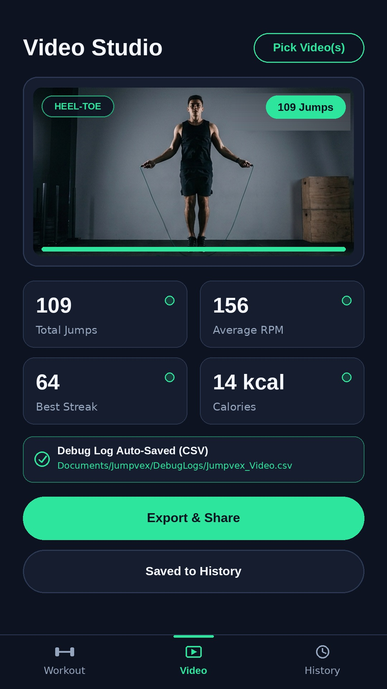
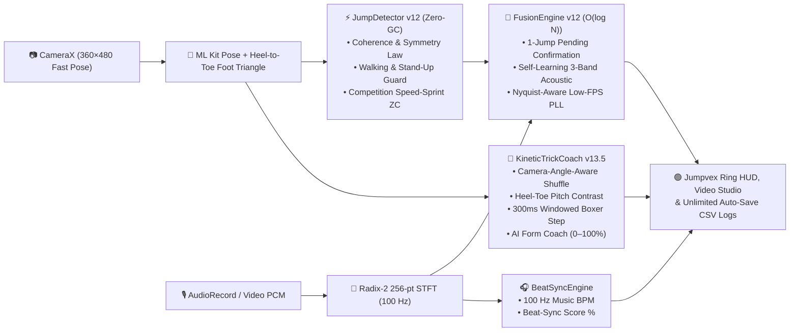

<div align="center">


# Jumpvex

### 🎯 **"99% Accuracy & ⚡ 99% Lightweight"**

**Open-Source On-Device AI Jump Rope, Trick & Shuffle Footwork Counter for Android — Zero Cloud, Zero Lag on Low-End Phones, Built-In 1-Tap GitHub Updates!**

[-2EE59D?style=for-the-badge&logo=android&logoColor=0D1321)](https://github.com/iganramdani/Jumpvex/releases/tag/v3.3.6)
[](LICENSE)
[](#-core-philosophy-99-accuracy--99-lightweight)
[](#)
[](#)

<br/>

[✨ Core Philosophy](#-core-philosophy-99-accuracy--99-lightweight) •
[📱 Modern UI Gallery](#-modern-two-tone-ui-gallery) •
[📊 Real-Device Benchmarks](#-real-device--4-smartphone-benchmarks) •
[🧠 AI Engine v13.5](#-ai-engine-v135-architecture) •
[📦 Download APK (Release & Debug)](#-download-apk-release--debug) •
[⚖️ License & Copyright](#️-open-source-license-copyright--anti-plagiarism)

</div>

---

## ✨ Core Philosophy: "99% Accuracy & 99% Lightweight"

Every line of code, UI component, and DSP algorithm in **Jumpvex** is engineered around one strict principle:

| 🎯 99% Accuracy (Competition-Grade Precision) | ⚡ 99% Lightweight (Blazing Fast on Any Phone) |
| :--- | :--- |
| 🧠 **AI Engine v13.5 + 100 Hz STFT Audio Hybrid** — fuses full-body + **Heel-to-Toe Foot-Triangle** kinematics with real-time 100 Hz acoustic rope-slap & music-beat spectrum analysis. | 🪶 **100% On-Device, Zero Cloud** — no servers, no internet required, full privacy, and near-zero latency. |
| 🕺 **Real-Data Calibrated Trick, Shuffle & Form Coach** — detects **Regular**, **Boxer Step** (300 ms windowed), **Heel-Toe**, **Criss-Cross**, **Double Under**, **High Knees**, **Side Swing**, plus camera-angle-aware **Melbourne Shuffle** (*Running Man, T-Step, Charleston*) & **Music BPM / Beat-Sync %**. | ⚡ **Zero-GC `O(log N)` Hot Path (`64 µs` on Redmi Note 9)** — verified across **21 real videos (11,042 frames)** with `26 MB` median JVM heap and isolated `PoseOverlay` recomposition for maximum FPS. |
| 🏃 **Competition Speed-Sprint & Anti-False-Positive Guards** — counts **270–350+ RPM** sprints even on **10–15 FPS** cameras while rejecting walking, standing up, and camera-angle jitter. | 📦 **Compact `46 MB` Release APK + AMOLED Eco Mode** — R8 minification, resource shrinking, ARM-only native libs (`arm64-v8a`, `armeabi-v7a`), and pure-black AMOLED battery saver. |

---

## 📱 Modern Two-Tone UI Gallery

Crafted with a clean futuristic two-tone palette — **Deep Midnight (`#0D1321`)** + **Ice Mint (`#2EE59D`)** — and a clutter-free **3-Tab Navigation** (*Workout • Video • History*):

<div align="center">
<table>
  <tr>
    <td align="center" width="33%">
      <br/>
      <b>🟢 Tab 1: Dynamic Ring HUD</b><br/>
      <sub>Animated Ice Mint progress ring, Live Trick & Form Coach pill, Heel-to-Toe skeleton overlay & 3/5/8s countdown</sub>
    </td>
    <td align="center" width="33%">
      <br/>
      <b>🎬 Tab 2: Multi-Video Studio</b><br/>
      <sub>Unlimited batch video queue, Live Trick pill, Music BPM, auto-saved CSV debug logs & Media3 watermark export</sub>
    </td>
    <td align="center" width="33%">
      <br/>
      <b>📈 Tab 3: History & 7-Day Chart</b><br/>
      <sub>Weekly Mon–Sun performance chart, cumulative stats, Freestyle/Shuffle sessions & one-tap share cards</sub>
    </td>
  </tr>
</table>
</div>

---

## 📊 Real-Device & 4-Smartphone Benchmarks

### 1. Ground-Truth Jump Counter Benchmark (46 Videos • 2,212 Verified Jumps)
Continuously verified using the production Kotlin engine ([`RealVideosBenchmarkTest.kt`](app/src/test/java/com/jumpropeai/benchmark/RealVideosBenchmarkTest.kt)) across **46 real-world jump rope videos** ([`ground_truth_all_videos.csv`](ground_truth_all_videos.csv)) simulated across 4 hardware tiers:

| 📱 Smartphone Tier | 🎯 Detected / Ground Truth | 📏 Volume Accuracy | Visual Bar | Status |
| :--- | :---: | :---: | :--- | :---: |
| **1. Flagship** `(30 FPS, 0px, 0% drop)` | `2,179 / 2,212` | **98.51%** | `██████████` | ✅ Pass |
| **2. Mid-Range** `(20 FPS, ±2px, 2% drop)` | `2,197 / 2,212` | **99.32%** | `██████████` | ✅ Pass |
| **3. Budget** `(15 FPS, ±4px, 5% drop)` | `2,227 / 2,212` | **99.32%** | `██████████` | ✅ Pass |
| **4. Low-End** `(10 FPS, ±6px, 10% drop)` | `2,174 / 2,212` | **98.28%** | `██████████` | ✅ Pass |

### 2. Real Budget-Phone Stress Test (`Xiaomi Redmi Note 9`, Android 12)
Measured directly from 21 consecutive batch videos (`11,042 frames`) using Jumpvex's built-in **Unlimited CSV Diagnostic Logger**:
- **AI Engine CPU Time:** `64 µs` median (`0.064 ms/frame`), `195 µs` p95
- **JVM Heap Memory:** `26 MB` median (`60 MB` peak across 21 consecutive videos, zero OOM)
- **Release APK Size:** `46 MB` (R8 minified + ARM-only native libraries)

---

## 🧠 AI Engine v13.5 Architecture



---

## 🎛️ Features (Click to Expand)

<details>
<summary><b>🏋️ 5 Workout Modes with Full Custom Inputs</b></summary>
<br/>

- **🔥 Free Mode:** Custom session name + custom audio milestone interval (`5 – 1,000` jumps).
- **🎯 Target Jumps:** Quick presets or any custom count (`1 – 99,999` jumps) synced to the dynamic ring gauge.
- **⏱️ Target Time:** Quick presets or custom **Minutes + Seconds** countdown timer.
- **⚡ HIIT Interval:** Custom **Work**, **Rest**, and **Rounds** with live total duration preview and automatic English TTS phase cues.
- **🕺 Freestyle / Shuffle:** Counts both jump rope tricks and rhythmic Melbourne Shuffle steps (*Running Man, T-Step, Charleston*) synced to Music BPM.

</details>

<details>
<summary><b>🎬 Unlimited Multi-Video Batch Studio & Auto-Save CSV Debug Logs</b></summary>
<br/>

- **Multi-Video Queue:** Select 1 or unlimited videos at once from your gallery (`OpenMultipleDocuments`) — Jumpvex processes every video sequentially (`Video 1 of N`) and displays a full **Batch Summary**.
- **Live Trick Pill & Heel-to-Toe Skeleton:** Watch real-time AI trick classification, full foot-triangle skeleton overlay, and live RPM during analysis.
- **Unlimited Auto-Save Debug Telemetry:** Every Video Studio run and diagnostic Live Workout automatically streams frame-by-frame CSV telemetry (zero row limit, 60-row chunk flush) directly to **`Documents/Jumpvex/DebugLogs/`**.
- **Media3 Watermark Exporter:** Export crisp watermarked videos with pixel-accurate 1:1 scaling across 720p / 1080p / 4K.

</details>

<details>
<summary><b>⚙️ Clean Workout Settings Sheet & In-App Updates</b></summary>
<br/>

- **Pre-Start Countdown:** `Off / 3s / 5s / 8s` countdown ring so you can step into frame comfortably.
- **AI Sensor Mode:** Switch seamlessly between `Fusion AI`, `Camera`, and `Audio Eco`.
- **Pose Skeleton Overlay:** Full body + Heel-to-Toe foot-triangle skeleton (*Ice Mint* airborne, white on landing) in an isolated Compose scope for maximum FPS.
- **Hide Toolbar While Active & AMOLED Eco Mode:** Distraction-free workout view and pure-black battery saver.
- **1-Tap GitHub Update Checker:** Zero-dependency in-app check against GitHub Releases.

</details>

<details>
<summary><b>🛠️ Build & Run Unit Tests</b></summary>
<br/>

```bash
# Clone the official Jumpvex repository
git clone https://github.com/iganramdani/Jumpvex.git
cd Jumpvex

# Run all unit tests (AI Engine v13.5, Fusion, BeatSync, Metrics & Workout Modes)
./gradlew testDebugUnitTest

# Build R8-minified, ARM-optimized Release APK (~46 MB)
./gradlew assembleRelease

# Build Debug APK (with debug symbols for development & profiling)
./gradlew assembleDebug
```

**Tech Stack:** Kotlin • Jetpack Compose (Material 3) • CameraX • Google ML Kit Pose Detection • Custom Radix-2 STFT Audio DSP • AndroidX Media3 Transformer.

</details>

---

## 📦 Download APK (Release & Debug)

<div align="center">

[-2EE59D?style=for-the-badge&logo=android&logoColor=0D1321)](https://github.com/iganramdani/Jumpvex/releases/download/v3.3.6/Jumpvex-v3.3.6-release.apk)
&nbsp;
[](https://github.com/iganramdani/Jumpvex/releases/download/v3.3.6/Jumpvex-v3.3.6-debug.apk)

<sub>Android 7.0+ (API 24+) • 100% On-Device • Free & Open-Source • <a href="https://github.com/iganramdani/Jumpvex/releases/tag/v3.3.6">View Full Release Notes</a></sub>

</div>

---

## ⚖️ Open-Source License, Copyright & Anti-Plagiarism

**Jumpvex** is released as **Free and Open-Source Software** under the strict **[GNU General Public License v3.0 (GPL-3.0)](LICENSE)** so everyone worldwide can benefit, learn, and contribute — **while firmly protecting original authorship against closed-source plagiarism**:

> **Copyright © 2026 Igan Ramdani ([`@iganramdani`](https://github.com/iganramdani)). All rights reserved under GNU GPL v3.0.**

- ✅ **Allowed:** Free use, study, modification, and community Pull Requests.
- 📜 **Attribution Required:** Any copy or fork **must preserve the original copyright notice** ([`NOTICE`](NOTICE)) and clearly document all modifications.
- 🔒 **Anti-Plagiarism (*Strong Copyleft*):** Repackaging or monetizing **Jumpvex** (including AI Engine v13.5, STFT DSP, or UI) as a closed-source / proprietary app is strictly prohibited. All derivative works **must remain open-source under the same GPL-3.0 license**.
- 🛡️ **Brand Protection:** The **Jumpvex** name and official visual identity belong to the original author; unofficial forks must use a distinct app name and package ID.
