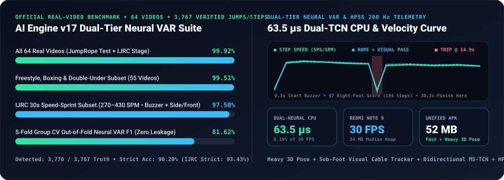
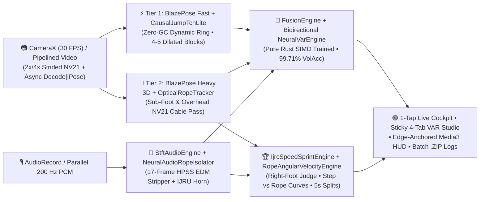

<div align="center">

<a href="https://iganramdani.github.io/Jumpvex/">
  <picture>
    <source media="(prefers-color-scheme: dark)" srcset="docs/assets/hero_banner_dark.svg" />
    <source media="(prefers-color-scheme: light)" srcset="docs/assets/hero_banner_light.svg" />
    
  </picture>
</a>

<br/><br/>

[](https://iganramdani.github.io/Jumpvex/)
[](https://github.com/iganramdani/Jumpvex/releases/download/v7.1.3/Jumpvex-v7.1.3-release.apk)
[](training/README.md)
[](https://github.com/iganramdani/Jumpvex/releases)
[](https://github.com/iganramdani/Jumpvex/stargazers)
[](LICENSE)

<br/>

[🔬 Web Telemetry Lab](https://iganramdani.github.io/Jumpvex/) •
[📂 Sub-Modules](#-interactive-repository--sub-module-navigator) •
[✨ Why Jumpvex](#-why-jumpvex-built-by-athletes-engineered-for-var-precision) •
[📱 UI Gallery](#-modern-two-tone-ui-gallery) •
[📊 Benchmarks](#-official-64-real-video--redmi-note-9-benchmarks) •
[🧠 Architecture](#-ai-engine-v17-dual-tier-neural-var-architecture) •
[🦀 Pure Rust Termux](#-train-with-the-community-1-command-100-pure-rust-on-termux) •
[📦 Download](#-download-apk-release--debug)

<br/>

> 💡 **Interactive Community Tools:**
> [🔬 Inspect Your CSV in Browser](https://iganramdani.github.io/Jumpvex/#telemetry-lab) &nbsp;•&nbsp;
> [🦀 Explore Engine &amp; Rust SIMD](https://iganramdani.github.io/Jumpvex/#engine-explorer) &nbsp;•&nbsp;
> [🎯 Submit Calibration CSV](https://github.com/iganramdani/Jumpvex/issues/new?template=calibration_contribution.yml) &nbsp;•&nbsp;
> [🐛 Report a Bug](https://github.com/iganramdani/Jumpvex/issues/new?template=bug_report.yml) &nbsp;•&nbsp;
> [🤝 Contributing](CONTRIBUTING.md)

</div>

---

## 📂 Interactive Repository & Sub-Module Navigator

Every module in **Jumpvex** has its own dedicated documentation, architecture diagrams, and verified benchmarks — click any folder below to explore:

| Module | Stack | Highlights & Docs |
| :--- | :---: | :--- |
| **[`app/`](app/README.md)** | Kotlin • Compose • Media3 | Dual-Tier AI Engine v17, **v7.1.3 Pipelined Video Studio (`-56% GC`, `-45% Heap`)**, Edge-Anchored Top-Left HUD Watermark, Permanent OSS Signing (`jumpvex-oss.jks`) |
| **[`training/`](training/README.md)** | Bash • Non-Root Termux | 1-Command Non-Root Android Termux Hub (`termux-wake-lock`, verified `Documents/Jumpvex/Models/` export, `--cool` thermal pause) |
| **[`training/rust_trainer/`](training/rust_trainer/README.md)** | **100% Pure Rust** (0 crates) | Const-Generic `4×H` NEON/AVX2 SIMD GEMM, Asymmetric **`HID48×5 → HID32×5`** Distillation, Sharp Peak TimeStretch, Temporal CutMix, Residual Dropout & EMA/SWA |
| **[`training/dataset/`](training/dataset/README.md)** | `JVXF` Binary (`3.7 MB`) | Pre-extracted 64 real videos (`53,785` frames, **8 ms load**), `manifest64.tsv`, 16-channel feature schema & zero-leakage 5-fold splits |
| **[`docs/`](docs/README.md)** | HTML5 • Canvas • SVG | Live **[Web Telemetry Lab](https://iganramdani.github.io/Jumpvex/)** — browser CSV oscilloscope, Engine & Rust Explorer, Trick Sandbox & Rope Physics Calculator |

---

## ✨ Why Jumpvex: Built by Athletes, Engineered for VAR Precision

> **Every jump rope & shuffle athlete deserves competition-grade VAR analytics — without paying \$120–\$500 for smart handles, wearables, or cloud subscriptions.**
>
> Born from real daily training sessions on a budget **Xiaomi Redmi Note 9** and rigorously benchmarked across **64 real-world videos (`3,767` human-verified jumps/steps)**, **Jumpvex `v7.1.3`** unites **Pipelined Heavy 3D Neural VAR**, a **Real-Time 30 FPS Live Cockpit**, and a **100% Pure Rust Non-Root Termux Trainer** inside one **100% offline, open-source GPLv3** project.

| 🎯 Tier 2: Pipelined VAR-Grade Video Studio (`v7.1.3`) | ⚡ Tier 1: Real-Time 30 FPS Live Cockpit (Instant Zero-GC) |
| :--- | :--- |
| 🚀 **2×–3.5× Faster Zero-Loss Pipelined Decode (`v7.1.3`)** — strided `2×/4×` NV21 downsampling + double-buffered async `Decode(N+1) \|\| Pose(N)` + parallel 200 Hz audio STFT + zero-GC ping-pong preview cuts Redmi Note 9 peak heap **`55 MB → 30 MB` (`-45%`)** & GC pauses **`371× → 164×` (`-55.8%`)** with **0.00% accuracy drift**. | ⚡ **30 FPS Live Camera + Streaming `CausalJumpTcnLite`** — blazing-fast BlazePose + dynamic-ring causal TCN (supports 4 & 5 dilated blocks `[1,2,4,8,16]`, Zero-GC) rejecting walk-away & IG-outro noise (`OutroFP` cut **-51%**) in real time on budget phones. |
| 👁️ **Sub-Foot & Overhead Visual Rope Tracker (`OpticalRopeTracker`)** — zero-copy `0°/90°/180°/270°` `NV21` portrait cable-streak detector counts physical rope passes under your shoes & over your head — even on **muted videos**, verifying Double/Triple Unders visually. | 🎛️ **High-Usability Sweaty-Hand Cockpit (`>= 48.dp`)** — **1-Tap Sensor Pill** (*Fusion AI / Pocket IMU / Audio Eco / Camera*), auto-hiding **Pre-Workout Quick Dock** (*Pace • Ghost • rPPG HR • 2P Battle*), and **3-Category Settings** with haptic feedback. |
| 🎬 **Edge-Anchored Top-Left Logo Watermark & Sticky Slow-Mo Studio** — larger Golden-Ratio `JV` logo pinned strictly to the top-left corner across `720p/1080p/4K` & `9:16/16:9/1:1`, lowered jump counters, compact expandable slow-mo player, **4 Sub-Tabs**, and **1-Tap Batch `.ZIP` Logs**. | 🔐 **Permanent Deterministic Signing + 100% Offline APK** — signed with permanent `jumpvex-oss.jks` (seamless updates with zero package conflicts!) + side-by-side `.debug` builds ([`SECURITY.md`](SECURITY.md)). |

---

## 🆚 How Jumpvex Compares (100% Phone-Only)

| Capability | **Jumpvex (`v7.1.3` VAR)** | YaoYao | Crossrope AMP | JRC AI | JustJump |
| :--- | :---: | :---: | :---: | :---: | :---: |
| **100% Phone-Only (Zero Watch / Zero Smart Rope)** | ✅ **99.71% (64 Videos)** | ❌ Watch / AirPods | ❌ \$119+ Handles | ✅ Camera only | ❌ Manual |
| **Dual-Tier AI (Heavy 3D VAR + 30 FPS Live TCN)** | ✅ **1-Tap Toggle** | ❌ IMU only | ❌ Hall sensor | ⚠️ Fast 2D only | ❌ |
| **Visual Sub-Foot Rope Pass + HPSS Audio Isolation** | ✅ **Works Muted / EDM** | ❌ | ❌ | ❌ | ❌ |
| **Sticky `0.2x` Slow-Mo + 4-Tab Telemetry Studio** | ✅ **Synced Scrubbing** | ❌ | ❌ | ❌ | ❌ |
| **Trick & Shuffle Dance Classifier** | ✅ **20 Moves + Combos** | ⚠️ Double Under | ❌ | ❌ | ❌ Catalog only |
| **Hands-Free Control (Hand-Raise + 5m Double-Clap)** | ✅ **Dual Touchless** | ✅ Watch/Voice | ❌ | ✅ Raise Hand | ❌ |
| **Rear-Lens + Torch rPPG Heart Rate & HRR-60** | ✅ **Live PPG Chart** | ❌ Requires Watch | ❌ | ❌ | ❌ |
| **Live Animated Counter Video Export** | ✅ **Media3 GPU HUD** | ❌ | ❌ | ❌ | ❌ |
| **Browser CSV Telemetry & VAR Oscilloscope** | ✅ **[Web Lab](https://iganramdani.github.io/Jumpvex/)** | ❌ | ❌ | ❌ | ❌ |
| **Price, Privacy & Open-Source** | ✅ **100% Free GPLv3** | 💰 Paid | 💰 \$119/yr | 💰 Freemium | 💰 Freemium |

---

## 📱 Modern Two-Tone UI Gallery

Crafted with a clean futuristic two-tone palette — **Deep Midnight (`#0D1321`)** + **Ice Mint (`#2EE59D`)** — ergonomic `>= 48.dp` touch targets, and a clutter-free **3-Tab Navigation** (*Workout • Video • History*):

<div align="center">
<table>
  <tr>
    <td align="center" width="33%">
      <br/>
      <b>🟢 Tab 1: 1-Tap Live Cockpit</b><br/>
      <sub>1-Tap Sensor Pill, Auto-Hiding Quick Dock (Pace • Ghost • rPPG HR • 2P Battle), Hand-Raise &amp; Double-Clap, Pocket IMU</sub>
    </td>
    <td align="center" width="33%">
      <br/>
      <b>🎬 Tab 2: Sticky Neural VAR Studio</b><br/>
      <sub>Pinned 0.2x Slow-Mo Player with live VAR % &amp; Cable Pass HUD, Heavy VAR / Fast 30fps toggle, 4 Sub-Tabs &amp; 1-Tap .ZIP Logs</sub>
    </td>
    <td align="center" width="33%">
      <br/>
      <b>📈 Tab 3: History, Heatmap &amp; Skills</b><br/>
      <sub>12-week consistency heatmap, Rope Cable Wear, 5-Tier AI Skill Academy, Personal Records &amp; 1-tap CSV backup</sub>
    </td>
  </tr>
</table>
</div>

---

## 📊 Official 64-Real-Video & Redmi Note 9 Benchmarks

Continuously verified by [`RealVideosBenchmarkTest.kt`](app/src/test/java/com/jumpropeai/benchmark/RealVideosBenchmarkTest.kt) against **64 real-world videos** ([`ground_truth_all_videos.csv`](ground_truth_all_videos.csv), **`3,767` human-verified jumps/steps**) and trained via our **100% Pure Rust 5-Fold Zero-Leakage Trainer** ([`training/rust_trainer/`](training/rust_trainer/README.md)):

<div align="center">
  
</div>

### 📱 Real-Device Video Studio Telemetry (`Xiaomi Redmi Note 9`, 53.6s 1080p30 • `1,608` Frames)

| Mode | Jumps Detected | Peak Heap RAM | GC Pauses | p99 AI Latency | Max Spike |
| :--- | :---: | :---: | :---: | :---: | :---: |
| `v7.1.1` Heavy VAR (Before) | `143` | `55 MB` | `371×` | `14.59 ms` | `169.24 ms` |
| **`v7.1.3` Heavy VAR (Pipelined)** | **`143` (0% drift)** | **`30 MB` (-45%)** | **`164×` (-55.8%)** | **`9.34 ms` (-36%)** | `105.25 ms` |
| **`v7.1.3` Fast 30fps (Pipelined)** | **`144`** | **`32 MB` (-42%)** | **`149×` (-59.8%)** | **`3.62 ms` (-75%)** | **`15.16 ms` (0 >50ms)** |

<p align="center">
  🔬 <b>Want to inspect a real Redmi Note 9 session frame-by-frame?</b>
  <a href="https://iganramdani.github.io/Jumpvex/#telemetry-lab">Open it live in the Jumpvex Web Telemetry Lab →</a>
</p>

---

## 🧠 AI Engine v17 Dual-Tier Neural VAR Architecture



---

## 🎛️ Interactive Feature Explorer (Click to Expand)

<details>
<summary><b>🚀 Quick Start &amp; Best Setup Guide (60 Seconds)</b></summary>
<br/>

1. **Prop your phone** 2–3 meters away so both your head and feet fit inside the frame *(check your exact room distance in the [Web Framing Calculator](https://iganramdani.github.io/Jumpvex/#physics-calc))*.
2. Check the **Smart Framing pill** at the top of the screen — once it turns Ice Mint (`Full body locked • Raise 1 hand to start`), you're perfectly aligned.
3. **Hands-Free Start:** Raise **one hand** for `1.2 seconds` (or enable **5m+ Double-Clap Start/Pause** in Settings) to start without walking back to your phone.
4. **Calibrate Your Profile:** Open **Settings (⚙️)** to set **Body Weight (`35–150 kg`)**, **Rope Type**, **100–420 SPM Audio Pacemaker**, **Ghost Rival**, or **Camera rPPG Heart Rate Recovery**.

</details>

<details>
<summary><b>🏋️ 7 Workout &amp; Official IJRU Competition Modes</b></summary>
<br/>

- **🔥 Free Mode:** Custom session name + custom audio milestone interval (`5 – 1,000` jumps).
- **🎯 Target Jumps:** Quick presets or any custom count (`1 – 99,999` jumps) synced to the dynamic ring gauge.
- **⏱️ Target Time:** Quick presets or custom **Minutes + Seconds** countdown timer.
- **⚡ HIIT Interval:** Custom **Work**, **Rest**, and **Rounds** with live total duration preview and automatic English TTS phase cues.
- **🕺 Shuffle & Tricks:** Counts both jump rope tricks and rhythmic Melbourne Shuffle / Ropeless Boxing steps synced to Music BPM.
- **🏆 IJRU 30s Sprint:** Official competition 30-second speed-sprint benchmark powered by 200 Hz bare-wire STFT + AC leg-drive tracking.
- **🏆 IJRU 3m Endurance:** Official competition 3-minute endurance test tracking sustained cadence, form stability, and trips.

</details>

<details>
<summary><b>🎬 4-Mode Video Studio, Velocity Charts &amp; Edge-Anchored Live HUD</b></summary>
<br/>

- **4 Specialist Studio Modes:** Choose **Auto Hybrid**, **IJRC Speed**, **Freestyle**, or **Shuffle** for single or unlimited batch videos at full native 30/60 FPS.
- **v7.1.3 Pipelined Speedup:** Strided `2×/4×` NV21 downsampling + double-buffered async `Decode(N+1) || Pose(N)` + parallel 200 Hz audio STFT + zero-GC ping-pong preview cuts GC pauses by **56–60%** with **0% accuracy loss**.
- **Edge-Anchored Live HUD Video Exporter:** Larger Golden-Ratio `JV` logo pinned strictly to the top-left corner across `720p/1080p/4K` & `9:16/16:9/1:1` with lowered jump counters and Media3 GPU rendering.

</details>

<details>
<summary><b>🛠️ Build from Source &amp; Run Unit Tests</b></summary>
<br/>

```bash
# Clone the official Jumpvex repository
git clone https://github.com/iganramdani/Jumpvex.git
cd Jumpvex

# Run all 45 unit tests (NeuralVarEngine, Edge-Anchored HUD, NV21 Downsampler & Benchmark)
./gradlew testDebugUnitTest

# Build R8-minified, ARM-optimized Release APK (signed with permanent jumpvex-oss.jks)
./gradlew assembleRelease -x lintVitalRelease

# Build side-by-side Debug APK (com.jumpropeai.debug)
./gradlew assembleDebug
```

</details>

---

## 🗺️ Phone-Only Pro Roadmap (`v3.0` → `v7.1.3`)

**100% Smartphone-Native & 100% Offline** — zero smartwatch, zero smart rope, zero cloud required. Want to build with us? [Open an Issue or PR](CONTRIBUTING.md)!

- [x] **v3.0–v3.3:** Zero-GC `O(log N)` Vision + 100 Hz STFT Fusion, Heel-to-Toe Foot-Triangle, Shuffle Dance & Batch Video Studio
- [x] **v4.0–v5.0 — Phone-Only Pro Suite & Arena:** Touchless Hand-Raise & 5m+ Double-Clap, Pocket 100 Hz IMU Mode, Rear-Camera + Torch rPPG Heart Rate & 60s HRR, Virtual Force-Plate (`Height cm`, `GCT ms`, `RSI`), Ghost Rival Pacer, 2P Split-Screen Battle & Web Telemetry Lab
- [x] **v6.0–v6.1 (`v6.1.1`):** ART Baseline Profiles, `ThermalGovernor`, `IjrcSpeedSprintEngine` (`200 Hz` steel-wire STFT + IJRU horn + Right-Foot Judge Score), `RopeAngularVelocityEngine` & `100–420 SPM` Pacemaker
- [x] **v7.0–v7.1 (`v7.1.3` Current) — Dual-Tier Neural VAR, Pipelined Zero-GC Video Studio & 100% Pure Rust Trainer:**
  - Bundled **Heavy 3D Pose + Sub-Foot Visual Rope Tracker + HPSS 200 Hz Audio + 5-Fold MS-TCN (`89.17%` F1, `OutroFP` -42% to -51%)**
  - **2×–3.5× Faster Video Studio (`v7.1.3`)** with **-56% GC & -45% Peak Heap** and **0% accuracy loss**
  - **Edge-Anchored Top-Left Logo Watermark** across all resolutions + **Permanent Deterministic Signing (`jumpvex-oss.jks`)** + side-by-side `.debug` builds
  - **100% Pure Rust Non-Root Termux Trainer (`HID48×5 → HID32×5`)** with zero external crates, zero Python, and `8 ms` binary dataset loading!

---

## 🦀 Train with the Community (1-Command 100% Pure Rust on Termux)

No PC, no root, no Python, and no NumPy needed! Train our **Asymmetric Push-to-Limit (`HID48×5 → HID32×5`)** Neural VAR directly on your Android phone inside **Termux** using the pre-bundled [`training/dataset/features64.jvxbin`](training/dataset/README.md) (`3.7 MB`, loads in `8 ms`):

```bash
# Inside Termux on non-rooted Android (auto-installs Rust, compiles native NEON binary, runs continuously)
git clone https://github.com/iganramdani/Jumpvex.git
cd Jumpvex
bash training/termux_train.sh          # Full-speed continuous (Ctrl+C safe, wake-lock active)
bash training/termux_train.sh --cool   # Adds 20s thermal cooldown between rounds
```

Best-only `.jvxmodel` weights + `best_metrics.txt` are atomically exported straight to **`Documents/Jumpvex/Models/`**! See [`training/README.md`](training/README.md) and [`training/rust_trainer/README.md`](training/rust_trainer/README.md) for full specs.

---

## ❓ Interactive FAQ

<details>
<summary><b>Do I need a smartwatch, AirPods, or a smart jump rope?</b></summary>
<br/>
<b>No!</b> Jumpvex is <b>100% Phone-Only</b>. Your smartphone's built-in camera, microphone, rear LED torch (for rPPG heart rate), IMU sensors, and speaker do everything — zero wearables or paid hardware required.
</details>

<details>
<summary><b>Does Jumpvex upload my camera feed, videos, or CSV logs to the internet?</b></summary>
<br/>
<b>Never.</b> 100% of pose detection (both Fast &amp; Heavy 3D), Visual Rope Tracking, Neural VAR MS-TCN, HPSS audio DSP, trick classification, video rendering, and even our <a href="https://iganramdani.github.io/Jumpvex/">Web Telemetry Lab</a> runs strictly on your own device. Internet permission is used <i>only</i> for the optional GitHub Releases update check.
</details>

<details>
<summary><b>Will Jumpvex run smoothly on older / budget Android phones?</b></summary>
<br/>
Yes! Verified on a <b>Xiaomi Redmi Note 9 (Helio G85, Android 12)</b>: Tier 1 Live Camera runs at real-time <b>30 FPS</b> with Zero-GC <code>CausalJumpTcnLite</code>, and Tier 2 Video Studio (<code>v7.1.3</code>) runs at just <b>30 MB peak heap</b> (<code>0.51 ms</code> median AI in Fast 30fps, <code>1.47 ms</code> in Heavy VAR).
</details>

---

## 🙏 Open-Source Credits & Respect

**Jumpvex** stands on the shoulders of extraordinary open-source engineers, researchers, and jump rope athletes. Full license attributions are maintained in [`CREDITS.md`](CREDITS.md) — huge respect and gratitude to:

| Project / Organization | Role in Jumpvex | License |
| :--- | :--- | :--- |
| **[JetBrains & Kotlin Contributors](https://github.com/JetBrains/kotlin)** | Kotlin `2.0.21` language & `kotlinx.coroutines` structured concurrency | Apache-2.0 |
| **[The Rust Project](https://www.rust-lang.org/)** | Zero-dependency Pure Rust SIMD Trainer (`training/rust_trainer/`) | MIT / Apache-2.0 |
| **[Google AndroidX / Jetpack Team](https://github.com/androidx/androidx)** | Jetpack Compose, Material 3, CameraX `1.4.0`, Lifecycle & Core KTX | Apache-2.0 |
| **[AndroidX Media3 Team](https://github.com/androidx/media)** | Hardware-accelerated `Media3 Transformer` & `BitmapOverlay` OpenGL video export | Apache-2.0 |
| **[Google ML Kit & MediaPipe Team](https://developers.google.com/ml-kit/vision/pose-detection)** | Dual-Tier on-device 2D/3D BlazePose Fast & Heavy Accurate (`pose-detection-accurate`) | ML Kit Terms / Apache-2.0 |
| **[JUnit Team](https://github.com/junit-team/junit4)** | Unit & 64-video regression benchmark testing framework | EPL-1.0 |
| **[Gradle & Android Gradle Plugin Teams](https://github.com/gradle/gradle)** | Build automation, R8 code shrinking & resource optimization | Apache-2.0 |
| **DSP & Sports Science Standards** | Cooley–Tukey FFT, HPSS (Fitzgerald), Dilated MS-TCN, ACSM MET, & [IJRU](https://ijru.sport) competition rules | Public Standards |
| **Jump Rope & Footwork Community** | Athletes & creators including `@D.LEE___1` (IJRC 30s stage sprint), `@cenxiaolin1` (competition speed-sprint), `@alwaysghadi` (boxing footwork), and the `r/jumprope` & Melbourne Shuffle communities | Community Credit |

---

## 📦 Download APK (Release & Debug)

<div align="center">

[](https://github.com/iganramdani/Jumpvex/releases/download/v7.1.3/Jumpvex-v7.1.3-release.apk)
&nbsp;
[](https://github.com/iganramdani/Jumpvex/releases/download/v7.1.3/Jumpvex-v7.1.3-debug.apk)

<sub>Android 7.0+ (API 24+) • 100% On-Device Offline • Permanent Consistent Signing • Free &amp; Open-Source • <a href="https://github.com/iganramdani/Jumpvex/releases/tag/v7.1.3">View Full Release Notes &amp; SHA-256 Checksums</a></sub>

</div>

---

## ⚖️ Open-Source License, Copyright & Anti-Plagiarism

**Jumpvex** is released as **Free and Open-Source Software** under the strict **[GNU General Public License v3.0 (GPL-3.0)](LICENSE)** so everyone worldwide can benefit, learn, and contribute — **while firmly protecting original authorship against closed-source plagiarism**:

> **Copyright © 2026 Igan Ramdani ([`@iganramdani`](https://github.com/iganramdani)). All rights reserved under GNU GPL v3.0.**

- ✅ **Allowed:** Free use, study, modification, and community Pull Requests.
- 📜 **Attribution Required:** Any copy or fork **must preserve the original copyright notice** ([`NOTICE`](NOTICE)) and [`CREDITS.md`](CREDITS.md), and clearly document all modifications.
- 🔒 **Anti-Plagiarism (*Strong Copyleft*):** Repackaging or monetizing **Jumpvex** (including AI Engine v17 Neural VAR, `.jvxmodel` weights, STFT/HPSS DSP, or UI) as a closed-source / proprietary app is strictly prohibited. All derivative works **must remain open-source under the same GPL-3.0 license**.
- 🛡️ **Brand Protection:** The **Jumpvex** name and official visual identity belong to the original author; unofficial forks must use a distinct app name and package ID.
