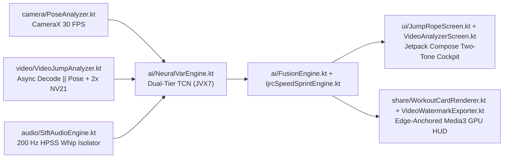

<div align="center">

# 📱 Jumpvex Android App (`app/`)

[](../README.md)
[](../README.md)
[-38BDF8?style=for-the-badge&logo=android&logoColor=0D1321)](../README.md)
[](src/test/java/com/jumpropeai)

**[← Back to Root Repo](../README.md)** • **[🦀 Rust Trainer](../training/README.md)** • **[🔬 Web Telemetry Lab](../docs/README.md)**

</div>

---

## 🧭 Module Architecture (`src/main/java/com/jumpropeai/`)



| Package | Key Files | Responsibility |
| :--- | :--- | :--- |
| **`ai/`** | `NeuralVarEngine.kt`, `FusionEngine.kt`, `JumpDetector.kt`, `OpticalRopeTracker.kt`, `IjrcSpeedSprintEngine.kt`, `KineticTrickCoach.kt`, `PlyometricAnalyzer.kt`, `TouchlessGestureController.kt` | Dual-Tier Neural VAR (`JVX7` dynamic loader supporting `HID_CH=24/32/48` & `4–5` dilated blocks), sub-foot NV21 rope vision, 20-trick classifier, and virtual force-plate metrics. |
| **`video/`** | `VideoJumpAnalyzer.kt` | **v7.1.3 Pipelined Video Studio**: 2×/4× strided NV21 downsampling, double-buffered async `Decode(N+1) \|\| Pose(N)`, parallel 200 Hz audio STFT, and zero-GC ping-pong preview `Bitmap`. |
| **`audio/`** | `StftAudioEngine.kt`, `NeuralAudioRopeIsolator.kt`, `PacemakerSynthesizer.kt`, `BeatSyncEngine.kt`, `DoubleClapDetector.kt` | 200 Hz 5-band STFT, 17-frame HPSS EDM music stripper, sample-accurate `100–420 SPM` pacemaker, and 5m+ hands-free Double-Clap trigger. |
| **`share/`** | `WorkoutCardRenderer.kt`, `VideoWatermarkExporter.kt` | Edge-anchored top-left `JV` brand HUD across `720p/1080p/4K` & `9:16/16:9/1:1` + Media3 Transformer hardware GPU video watermark export. |
| **`sensors/`** | `PocketImuEngine.kt`, `OpticalHeartRateScanner.kt` | 100 Hz screen-off pocket accelerometer jump counter & rear-camera + torch rPPG heart rate / 60s HRR scanner. |
| **`ui/`** | `JumpRopeScreen.kt`, `VideoAnalyzerScreen.kt`, `HistoryTabScreen.kt`, `VideoTelemetryCharts.kt`, `WorkoutSettingsSheet.kt` | 3-tab Jetpack Compose cockpit (*Workout • Video • History*), `>= 48.dp` sweaty-hand targets, compact sticky slow-mo studio. |
| **`data/`** | `WorkoutSqliteStore.kt`, `WorkoutHistoryRepository.kt`, `WorkoutSession.kt` | Local SQLite WAL persistence, 12-week heatmap, cable wear tracker, and 1-tap CSV export. |
| **`assets/models/`** | `var_bitemporal_v7.jvxmodel`, `live_causal_tcn_v7.jvxmodel` | Bundled offline `JVX7` neural weights trained via the [100% Pure Rust Trainer](../training/rust_trainer/README.md). |

---

## ⚡ v7.1.3 Video Studio Performance (Real Redmi Note 9 Telemetry)

Measured on the exact same 53.6s 1080p30 video (`1,608 frames`, `143` verified jumps) on **Xiaomi Redmi Note 9 (Helio G85, Android 12)**:

| Metric | `v7.1.1` Heavy VAR | **`v7.1.3` Heavy VAR** | **`v7.1.3` Fast 30fps** |
| :--- | :---: | :---: | :---: |
| **Detected Jumps** | `143` | **`143` (0.00% drift)** | **`144`** |
| **Peak JVM Heap** | `55 MB` | **`30 MB` (-45%)** | **`32 MB` (-42%)** |
| **GC Pauses (`>= 8 MB` drop)** | `371×` | **`164×` (-55.8%)** | **`149×` (-59.8%)** |
| **p99 / Max AI Latency** | `14.59 ms` / `169.24 ms` | **`9.34 ms` / `105.25 ms`** | **`3.62 ms` / `15.16 ms`** |

---

## 🔐 Deterministic Signing & Coexistence

- **Permanent OSS Keystore ([`jumpvex-oss.jks`](jumpvex-oss.jks)):** Ensures every GitHub Actions release APK is signed with the exact same certificate (`CN=Jumpvex Open Source`) so upgrades (`v7.1.2 → v7.1.3 → v7.2.0+`) install directly over previous versions without package-conflict errors.
- **Side-by-Side Debug Builds:** `debug` builds use `applicationIdSuffix = ".debug"` (`com.jumpropeai.debug`), allowing Debug and Release APKs to coexist cleanly on the same phone.

---

## 🛠️ Build & Test Commands

<details>
<summary><b>Click to expand Gradle commands</b></summary>
<br/>

```bash
# Run all unit tests (including NeuralVarEngineTest & Watermark / NV21 tests)
./gradlew testDebugUnitTest

# Build R8-minified, ARM64 + ARMv7 offline Release APK
./gradlew assembleRelease -x lintVitalRelease

# Build side-by-side Debug APK (com.jumpropeai.debug)
./gradlew assembleDebug
```

</details>
