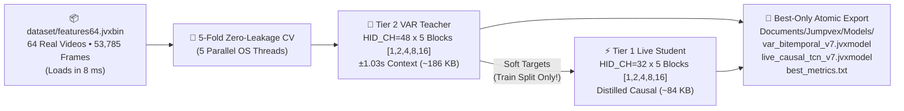

<div align="center">

# 🦀 Jumpvex Training Hub (`training/`)

[](rust_trainer/README.md)
[](termux_train.sh)
[-38BDF8?style=for-the-badge)](dataset/README.md)

**[← Back to Root Repo](../README.md)** • **[🦀 Rust SIMD Engine](rust_trainer/README.md)** • **[📦 64-Video Dataset](dataset/README.md)** • **[📱 Android App](../app/README.md)**

</div>

---

## 🚀 1-Command Non-Root Android Termux Training

Train Jumpvex's Dual-Tier Neural VAR models **100% offline directly on your Android smartphone** — **zero root, zero Python, zero NumPy, zero Google Drive, zero PC required**:

```bash
# Inside Termux on Android (auto-installs Rust, compiles native ARM64 NEON binary, runs continuous training)
cd ~/Jumpvex && git pull && bash training/termux_train.sh
```

### Interactive CLI Options

| Command | Behavior |
| :--- | :--- |
| `bash training/termux_train.sh` | **Continuous Full-Speed** all-core training until you press `Ctrl+C` (safe atomic stop). |
| `bash training/termux_train.sh --cool` | Adds a **20-second thermal cooldown** between rounds so your phone stays cool. |
| `bash training/termux_train.sh --cool 30` | Custom **30-second** thermal cooldown between rounds. |
| `bash training/termux_train.sh --rounds 5` | Runs **exactly 5 continuous rounds**, saves checkpoint, and exits cleanly. |
| `bash training/termux_train.sh --reset` | Clears `training/checkpoints/checkpoint_v7.jvxckpt` and starts fresh from Round 1. |

---

## 🧠 Asymmetric Push-to-Limit Distillation Pipeline (`v7.2`)



---

## 📂 Sub-Directories

| Folder / File | Purpose |
| :--- | :--- |
| **[`rust_trainer/`](rust_trainer/README.md)** | Zero-dependency Pure Rust SIMD Trainer (`4×H` register-blocked GEMM, Sharp Peak Time-Stretching, Temporal CutMix, Inverted Residual Dropout, EMA/SWA). |
| **[`dataset/`](dataset/README.md)** | Bundled 64-real-video dataset (`features64.jvxbin` `3.7 MB`, `manifest64.tsv`, 64 pose TSVs & 63 WAVs). |
| **[`termux_train.sh`](termux_train.sh)** | Non-root Android Termux launcher with automatic `termux-setup-storage` verification, `termux-wake-lock` (screen-off safe), and zero git-conflict local export to `Documents/Jumpvex/Models/`. |
